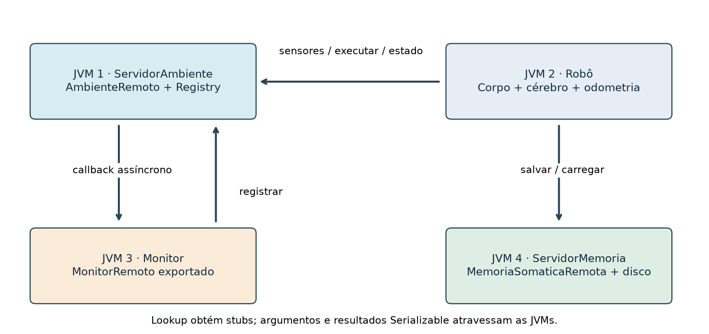
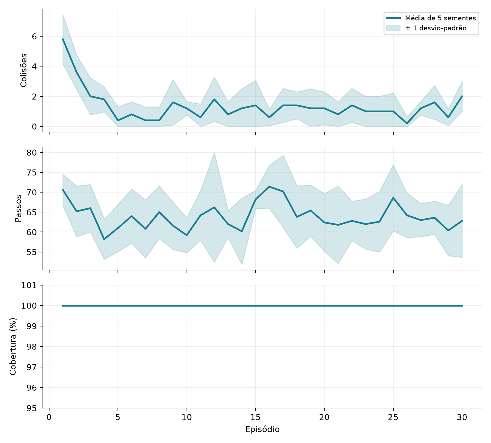
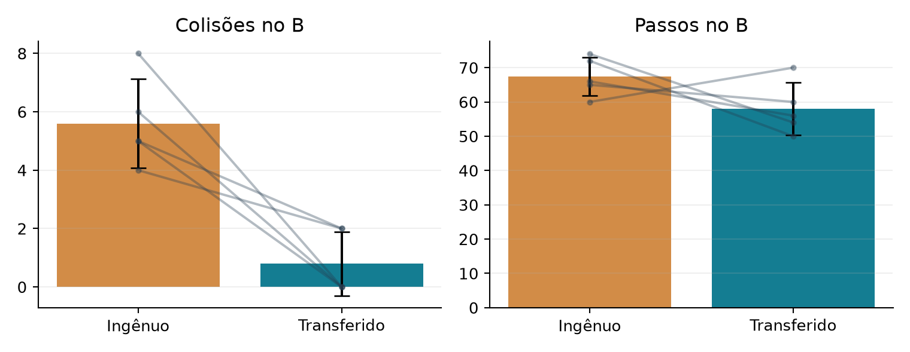

# Robô homeostático distribuído

Aprendizado emocionalcom Java RMI

Sistemas Distribuídos · Bacharelado em Sistemas de Informação

Jefferson SilvaRA: Não informado

Relatório técnico e experimental17 de novembro de 2026

Escopo desta versão

Aplicação Java executada com quatro papéis distribuídos, 150 episódios de treino e 10 episódios de transferência. Os resultados e exemplos apresentados foram extraídos dos CSVs e logs produzidos pela execução, sem preenchimento manual de métricas.

Pendências para submissão: receber e integrar o pacote comum oficial; preencher RA e demais integrantes conforme a regra de grupos de 5 a 6; confirmar a divisão de tarefas. A compatibilidade com o servidor do professor e o teste de laboratório ainda não foram verificados.

O material de apoio recebido contém exemplos de calculadora e banco, preservados em rmi/. Eles não fornecem o contrato completo do robô. A capa registra somente a pessoa informada pelo usuário; não atribui autoria ou participação a pessoas não confirmadas.


---

# 1. Validação e requisitos da atividade

O enunciado tem 15 páginas e pede dois entregáveis: relatório PDF de 10 a 20 páginas e ZIP com fontes Java, mapas, CSVs e README. A solução deve usar Java RMI, sem sockets diretos, bibliotecas externas na aplicação, interface gráfica ou desenho da matriz na saída. As instruções do documento foram usadas como requisitos da atividade solicitada.

| Requisito | Implementação / evidência |
| --- | --- |
| Quatro processos e contrato RMI | ServidorAmbiente, ServidorMemoria, Monitor e Robo, cada um com main. |
| Mundo 6 × 6 e percepção parcial | Mapa somente no servidor; cinco sensores booleanos; odometria no robô. |
| Modelo homeostático | Energia, integridade e tédio; cinco emoções; recompensa por redução do impulso. |
| Aprendizado e memória | Tabela de marcadores persistida; memória espacial reiniciada por episódio. |
| Experimentos mínimos | 30 episódios × 5 sementes no A; 5 pares de primeiro episódio no B. |
| Integração oficial | Pendente: DTOs reconstruídos localmente, sem garantia de identidade com os oficiais. |

Decisões de interpretação

As 29 células livres citadas na figura do ambiente A são interpretadas como transitáveis: incluem a origem e as cinco pedras. O arquivo tem 7 obstáculos, 23 pontos livres, 5 pedras e 1 origem. A cobertura conta a origem e divide as células visitadas por 29. Ambos os mapas foram verificados como conexos pelo servidor.

Cada ação, inclusive RECOLHER, consome um passo. Colisão muda a orientação mesmo sem deslocamento. Revisita significa entrar por movimento em local já visitado; colisão e coleta não contam revisita. A energia zero não encerra por si só a execução, pois o enunciado não determina morte por falta de energia.

O servidor impede ações após 400 passos. O cliente pode encerrar antes ao esgotar as fronteiras conhecidas e recolher a pedra da posição atual. O encerramento devolve métricas calculadas pelo servidor. Datas de entrega e laboratório estão em branco no documento e continuam não confirmadas.


---

# 2. Fundamentação teórica

Homeostase como origem da motivação

Homeostase é a regulação de condições internas compatíveis com a manutenção do organismo. Um ponto de ajuste fornece referência, e o afastamento cria necessidades. No problema, energia e integridade representam recursos e dano; tédio representa uma necessidade artificial de exploração. A analogia não transforma o programa em organismo: são variáveis computacionais escolhidas para orientar decisões, conforme a proposta didática do enunciado [1].

Man e Damasio [2] propõem investigar máquinas cuja motivação esteja vinculada à preservação de suas condições internas. A homeostase daria uma base para avaliar o que acontece com a própria máquina. O artigo é uma perspectiva sobre condições para máquinas inspiradas em sentimentos; não comprova que uma tabela de valores produza experiência subjetiva. Nesta atividade, esse princípio orienta a escolha de uma recompensa corporal, sem reivindicar consciência.

Emoção, sentimento e representação de si

No modelo didático, emoção é um programa de resposta: medo e angústia tornam a escolha mais concentrada, enquanto tédio aumenta a variação e mobiliza a memória. Sentimento é representado apenas pela leitura explícita do estado do corpo e seu registro. Damasio [3] relaciona o self à representação continuada do organismo e aos sinais corporais modificados na interação com o ambiente. Aqui, o registro numérico é uma abstração funcional, não um equivalente completo dessa experiência.

A interpretação dos níveis de self segue o enunciado [1]: o proto-self corresponde ao acompanhamento de energia, integridade e tédio; o self central, à associação entre um evento e a alteração corporal; o self autobiográfico, à memória acumulada que influencia decisões futuras. A memória espacial guarda a história do episódio, enquanto a tabela somática guarda regularidades transferíveis entre episódios.

Marcadores e aprendizado por reforço

Um marcador somático associa uma situação e uma escolha a consequências corporais anteriores. A colisão deteriora a integridade; a variação negativa do bem-estar reduz o valor aprendido daquela escolha. Nenhum valor negativo é instalado previamente na tabela. Assim, o sensor indica uma condição observada, mas é a experiência que a torna aversiva na política probabilística.

Keramati e Gutkin [4] formulam aprendizado por reforço homeostático em que recompensa expressa a restauração do equilíbrio interno. Essa ligação sustenta usar a redução do impulso como sinal de aprendizado. A implementação adota uma distância ponderada simples e atualização por diferença temporal; não reproduz integralmente o modelo biológico ou as demonstrações do artigo.


---

# 3. Arquitetura distribuída e ciclo RMI

Figura 1 — Processos, objetos remotos e principais chamadas. Não há troca de mapas com o robô.



O ambiente exporta AmbienteRemoto; a memória exporta MemoriaSomaticaRemota. Cada servidor usa rebind no Registry. O robô faz lookup e chama os métodos através dos stubs. O monitor é cliente ao registrar-se e servidor ao disponibilizar notificar. Os DTOs são Serializable; os objetos de serviço implementam Remote, seguindo a organização documentada pela Oracle [5].

| Ordem | Operação de um passo |
| --- | --- |
| 1 | Robô lê sensores e atualiza sua memória local. |
| 2 | Cérebro escolhe reflexo, deliberação ou amostragem dos marcadores. |
| 3 | executar(id, ação) aplica a ação, conta o passo e enfileira evento. |
| 4 | Robô atualiza odometria e corpo; lê sensores seguintes e aprende. |
| 5 | publicarEstado envia emoção, variáveis, bem-estar e recompensa. |
| 6 | Workers do ambiente entregam eventos ao monitor fora da thread da ação. |

Ao iniciar um episódio, o servidor devolve a pose inicial e repõe as pedras da sessão. Ao terminar, encerrarEpisodio devolve a verdade das métricas do mundo. Ao final do treino, salvar envia somente a tabela somática ao servidor de memória. No B, carregar recupera essa tabela; a memória espacial começa vazia novamente.


---

# 4. Concorrência, callback e falhas

Sessões independentes

Um ConcurrentHashMap associa idRobo a uma Sessao. A estrutura estática do mapa é compartilhada para leitura; cada sessão tem suas próprias pedras, pose, células visitadas e contadores. Métodos sobre uma mesma sessão usam synchronized. Dessa forma, verificação do limite, aplicação de ação e incremento de contadores formam uma operação indivisível. IDs diferentes não compartilham as variáveis mutáveis.

```java
Sessao s = sessao(id);
synchronized (s) {
    ResultadoAcao resultado = s.executar(acao);
    notificador.publicar(evento); // apenas enfileira
    return resultado;
}
```

O trecho resume ServicoAmbiente.executar. O reinício troca a sessão associada ao ID; não há suporte a dois controladores simultâneos para o mesmo robô. Cada cliente deve usar ID exclusivo. O contrato não contém token que permita distinguir dois donos do mesmo identificador.

Entrega assíncrona com recursos limitados

Notificador mantém um worker daemon por monitor, fila limitada a 8.192 eventos e até 32 monitores. A publicação usa offer, que não espera espaço. Uma fila cheia remove o observador sobrecarregado. Exceção na chamada também remove o monitor. Um vigia remove chamadas com mais de três segundos. Workers separados impedem que um observador lento atrase os demais.

A ordem é preservada dentro de cada fila enquanto o monitor está registrado. Os eventos contêm episódio, passo e ID na descrição. O callback é observacional: sua falha não invalida uma ação já executada. Não há promessa de entrega exatamente uma vez nem retenção durável dos eventos. Nos experimentos, os logs registraram todos os 9.587 eventos de ação e 9.587 estados do treino.

Limites da tolerância a falhas

Interromper uma thread não garante cancelar uma chamada RMI bloqueada no transporte. A execução documentada acrescenta responseTimeout=2500 ms do Oracle/OpenJDK. O worker daemon isolado mantém o robô livre, mas desconexões patológicas ainda podem reter recursos até o transporte desistir. A aplicação foi desenhada para o laboratório, sem autenticação ou descoberta de falhas distribuída.

Falha na ação remota interrompe o robô sem repetição automática, evitando duplicar ações após perda de resposta. A memória serializa acessos, grava um temporário e substitui o arquivo final atomicamente quando o sistema permite. O nome deriva de SHA-256 da chave, não de um caminho fornecido pelo cliente. Isso não equivale a uma base transacional com tolerância a perda de energia.


---

# 5. Corpo, impulso e emoções

| Variável | Faixa / ajuste | Dinâmica por ação |
| --- | --- | --- |
| Energia E | 0–100 / 100 | −1 sempre; −1 adicional na colisão; +15 ao recolher pedra. |
| Integridade I | 0–100 / 100 | −25 na colisão; +2 em ação sem colisão. |
| Tédio T | 0–100 / 0 | −30 ao entrar em local novo; +10 ao entrar em local visitado. |

O corpo inicia em (100, 100, 0). Todos os valores são limitados ao intervalo definido após cada atualização. Coletar uma pedra funciona como alimentação; o ganho externo de uma pedra não é usado diretamente como pontuação de aprendizado.

```java
D = (100 - E)/100 + 1.5*(100 - I)/100 + T/100
bemEstar = -D
recompensa = D_antes - D_depois
```

| Emoção | Condição, em ordem de prioridade | Temperatura |
| --- | --- | --- |
| Medo | Colisão atual ou I < 60 | 0,05 |
| Angústia | E < 25 | 0,05 |
| Alegria | Recompensa > 0,15 | 0,10 |
| Tédio | T >= 50 | 0,30 |
| Calma | Nenhuma condição anterior | 0,10 |

As emoções alteram a distribuição softmax: temperaturas menores concentram as escolhas nos valores mais altos; tédio distribui mais a probabilidade. Alegria e calma compartilham temperatura, conforme a referência, mas medo, angústia e tédio têm efeitos comportamentais distintos do estado neutro. O impulso de tédio também ativa busca na memória.

Conferência numérica

Partindo de E=80, I=100, T=40, o impulso é 0,60. Uma colisão produz E=78, I=75, T=40: impulso 0,995 e recompensa −0,395. Um movimento a célula nova produz impulso 0,31 e recompensa +0,29. Uma revisita produz impulso 0,71 e recompensa −0,11. Os três casos são verificados automaticamente.

Com E=70, I=90, T=20, recolher produz E=84, I=92, T=20 e recompensa +0,17. A recompensa depende do corpo: a mesma pedra pode produzir ganho menor quando a energia já está perto do teto. Da mesma forma, dano e exploração perdem sinal adicional quando as variáveis saturam.


---

# 6. Decisão, memória e aprendizado

A primeira camada é um reflexo permitido no enunciado: se P estiver ativo, recolher. A segunda usa busca em largura em células reveladas pelos sensores quando T >= 50 e não há vizinho livre ainda não visitado. A terceira amostra entre quatro movimentos por softmax. Essa última camada nunca exclui uma ação por encontrar um sensor de obstáculo; com marcadores zerados, as quatro probabilidades são iguais.

Ajuste ao modelo de referência: a deliberação depende do nível de tédio, mesmo se medo ou angústia forem a emoção dominante. Isso representa impulsos coexistentes e evita que prioridade emocional suprima indefinidamente a exploração. A busca usa apenas células livres observadas, como a camada deliberativa sugerida pelo enunciado. Logo, não se atribui toda a navegação ao aprendizado: há reflexo e planejamento espacial explícitos.

Representação local e regra de atualização

Para cada ação candidata, a situação combina dois atributos: bloqueio na direção correspondente e destino já visitado. Exemplos: bloqueio=true;visitada=false e bloqueio=false;visitada=true. A tabela guarda cinco valores por chave, um por ação. Coleta usa a chave pedra=true. Coordenadas e orientação absoluta não são salvas na memória somática; isso favorece a transferência de regularidades locais.

```java
M(s,a) <- M(s,a) + 0.5 * (r + 0.9 * futuro - M(s,a))
futuro = max dos valores das acoes no proximo estado
futuro = 0 quando o episodio termina
```

A coleta, quando disponível, é a única ação considerada no bootstrap seguinte, coerente com o reflexo. Nos outros estados, calcula-se o máximo entre os quatro movimentos. A softmax subtrai o maior valor antes da exponenciação, reduzindo risco de overflow. Uma colisão inicial com futuro zero atualiza o marcador de 0 para −0,1975.

| Conceito | Classe / método e papel |
| --- | --- |
| Proto-self / homeostase | Corpo: variáveis, impulso() e estado(). |
| Self central / consequência | Corpo.sentir(): vincula o resultado ao corpo e à recompensa. |
| Emoção | Emocao.temperatura e Cerebro.escolher(): mudam a distribuição. |
| Self autobiográfico | MemoriaEspacial.observar(), atualizar() e caminhoAteFronteira(). |
| Marcador somático | Cerebro.aprender(), exportar() e ServicoMemoria.salvar()/carregar(). |


---

# 7. Protocolo experimental reproduzível

A aplicação foi compilada com Oracle JDK 25.0.1, alvo Java 8, em Windows. Todas as interações do robô com ambiente e memória passaram por RMI. O script Python apenas iniciou JVMs, aguardou prontidão, coletou arquivos e encerrou os processos que criou; ele não simulou o mundo nem selecionou ações.

| Etapa | Configuração |
| --- | --- |
| Treino A | Sementes 1, 2, 3, 4 e 5; 30 episódios por semente; no máximo 400 ações. |
| Entre episódios | Persistem os marcadores; reiniciam corpo, memória de locais, pose e pedras. |
| Entre sementes | Novo cérebro com tabela zerada; novo gerador pseudoaleatório. |
| Persistência | Salvar chave semente-N no servidor; parar a JVM da memória e reiniciá-la com a mesma pasta. |
| Transferência B | Primeiro episódio de robô ingênuo e de robô carregado, para cada semente. |
| Controle | Mesma semente nos dois tratamentos; ambos podem aprender dentro do episódio. |
| Saída | 150 linhas de treino e 10 linhas de transferência; logs de monitor e tabelas finais. |

Mapas e condição de término

A usa origem (0,0), orientação norte, 7 obstáculos e 5 pedras. B usa origem (5,5), orientação norte, com obstáculos e pedras redistribuídos; mantém 29 posições transitáveis e 5 pedras. A conectividade foi checada pela carga dos mapas. Os arquivos ficam em mapas/ e são lidos exclusivamente pelo servidor.

A memória espacial começa com a origem e incorpora apenas vizinhos detectados. Para um mapa conexo, se cada célula visitada foi observada e não restam vizinhos livres conhecidos sem visita, nenhuma célula alcançável pode estar faltando: um caminho até uma célula faltante teria uma primeira fronteira ainda não visitada. Esse critério permite concluir a exploração sem conhecer o mapa completo previamente.

Métricas e análise

Passos, colisões, pedras, revisitas, células visitadas, denominador da cobertura e motivo de término vêm do relatório do servidor. Energia final vem do corpo. Os gráficos usam média e desvio-padrão entre cinco sementes por episódio. Comparações dos primeiros e últimos cinco episódios são descritivas; os episódios de uma mesma semente não são observações independentes.

O ensaio A→B foi definido com um único mapa B. A condição ingênua não é um controle sem aprendizado: começa com valores zero e os atualiza. A condição transferida começa com os valores treinados, mantendo as demais regras. Não houve seleção da melhor semente nem exclusão de episódios malsucedidos.


---

# 8. Resultados do treino no ambiente A

Figura 2 — Média e ±1 desvio-padrão entre sementes. Cobertura constante em 100%; não há ganho de cobertura a atribuir ao treino.



| Métrica | Episódios 1–5 | Episódios 26–30 |
| --- | --- | --- |
| Colisões médias | 2,72 | 1,12 |
| Passos médios | 64,20 | 62,80 |
| Revisitas médias | 28,48 | 28,68 |

Os 150 episódios terminaram com 100% de cobertura e cinco pedras. A média de colisões caiu 58,8% entre as janelas; os passos caíram apenas 2,2%. As revisitas não melhoraram. O resultado sustenta aprendizado de aversão a colisões, mas não otimização consistente das rotas. A política permanece probabilística.


---

# 9. Evidências dos marcadores e emoções

| Situação da ação | Ação | Antes | Após 30 ep. |
| --- | --- | --- | --- |
| bloqueio=true;visitada=false | FRENTE | 0,0000 | -0,4140 |
| bloqueio=true;visitada=false | TRAS | 0,0000 | -0,1975 |
| bloqueio=false;visitada=false | FRENTE | 0,0000 | 0,3477 |
| bloqueio=false;visitada=false | TRAS | 0,0000 | 0,4074 |
| bloqueio=false;visitada=true | FRENTE | 0,0000 | -0,1211 |
| bloqueio=false;visitada=true | TRAS | 0,0000 | -0,0950 |

A tabela é da semente 1. Os quatro movimentos diante de bloqueio ficaram negativos; movimentos a células novas ficaram positivos. Valores diferentes entre ações refletem trajetórias, frequências e recência distintas. A representação é compacta, mas mistura diferentes estados de energia e integridade numa mesma chave; não é um estado markoviano completo.

Trechos reais do monitor

| Episódio | Passo | Emoção | Recompensa | Temperatura |
| --- | --- | --- | --- | --- |
| 1 | 1 | MEDO | -0.3950 | 0.05 |
| 1 | 37 | ALEGRIA | 0.3200 | 0.1 |
| 1 | 34 | TEDIO | -0.0800 | 0.3 |

No primeiro passo da semente 1, ESQUERDA causou colisão: E=98, I=75, T=0 e recompensa −0,395. O medo resultante passa a temperatura para 0,05 na decisão seguinte. A tabela resume campos dos eventos originais, preservados integralmente em resultados/monitorA.log.

No conjunto do treino foram registrados 5.799 estados de calma, 2.192 de tédio, 1.132 de alegria e 464 de medo; 1.483 decisões usaram a memória deliberativa. Angústia não apareceu nesses ensaios, mas sua condição e temperatura foram verificadas em teste controlado. Logo, não se afirma observação experimental das cinco emoções nos mapas A e B.

O estado publicado é posterior à ação; sua emoção governa a próxima escolha. O indicador deliberacao descreve a escolha recém-executada, podendo aparecer junto de outra emoção produzida pelo resultado. Essa distinção impede interpretar o log como se a emoção posterior tivesse causado retroativamente a ação.


---

# 10. Indagação 1: generalização A → B

Figura 3 — Primeiro episódio no B. Barras: média ± desvio-padrão; linhas finas conectam as mesmas sementes.



| Semente | Colisões ing./transf. | Passos ing./transf. |
| --- | --- | --- |
| 1 | 5 / 2 | 65 / 60 |
| 2 | 6 / 0 | 60 / 70 |
| 3 | 5 / 0 | 66 / 56 |
| 4 | 8 / 0 | 74 / 54 |
| 5 | 4 / 2 | 72 / 50 |

As colisões passaram de 5,6 ± 1,52 para 0,8 ± 1,10; os passos, de 67,4 ± 5,64 para 58,0 ± 7,62. A redução média foi de 85,7% nas colisões e 13,9% nos passos. Todos os dez episódios chegaram a 100% de cobertura e cinco pedras.

Resposta: houve transferência útil neste ambiente diferente, especialmente da aversão a bloqueios. As chaves dependem de relações locais observáveis, não de coordenadas de A. O conhecimento de caminhos e da posição das pedras não se transferiu: a memória espacial foi reiniciada e reconstruída por sensores no B.

A melhora não foi uniforme: na semente 2, o transferido fez 70 passos contra 60 do ingênuo, embora não tenha colidido. A energia final média também foi menor, 78,4 contra 81,0; o teto de energia e a ordem de coleta afetam esse saldo. Não há prova de superioridade em toda métrica ou em qualquer ambiente 6 × 6. Cinco pares e um mapa alternativo sustentam apenas uma conclusão local e descritiva.


---

# 11. Indagação 2: aplicações além da robótica

Resposta: o princípio pode orientar outros agentes adaptativos quando há variáveis internas mensuráveis, faixas desejadas, ações que alteram essas variáveis e consequências observáveis no tempo. A tradução exige definir o que funciona como corpo e justificar os pontos de ajuste. Não existe no projeto um algoritmo universal de Damásio: há uma implementação computacional inspirada em sua teoria.

Exemplo 1 — Gerenciamento de um serviço distribuído

Corpo proposto: conjunto de réplicas de um serviço. Variáveis e ajustes ilustrativos: CPU próxima de 60%, latência p95 abaixo de 200 ms, taxa de erros abaixo de 1% e reserva de capacidade acima de 20%. Um impulso pondera violações dessas faixas. Ações possíveis: criar ou remover réplicas, redistribuir requisições, limitar admissão e desabilitar uma dependência instável.

Emoções artificiais propostas: medo após erros reduz exploração de configurações; angústia por sobrecarga favorece políticas já eficazes para recuperar capacidade; alegria após recuperação mantém uma configuração promissora; tédio em regime estável permite experimentação limitada. Um marcador associa perfil de carga e ação à redução posterior do impulso. A recompensa deve considerar custo e estabilidade para evitar criar réplicas indefinidamente.

A proposta é uma extensão de engenharia, não um resultado medido aqui. A computação autonômica discute sistemas capazes de gerenciar aspectos de sua própria operação [6]; esse é um contexto adequado para formular variáveis internas, observar efeitos e fechar um ciclo adaptativo. Isso não demonstra que emoções simuladas superem um controlador convencional.

Exemplo 2 — Gestão de estoque e reposição

Corpo proposto: operação de um almoxarifado. Variáveis e ajustes ilustrativos: cobertura de estoque próxima de 14 dias, capital imobilizado até um orçamento definido e perdas por vencimento abaixo de 1%. Ações: alterar lote, antecipar compra, trocar fornecedor e redistribuir itens entre depósitos. O impulso combina falta, excesso e desperdício, com pesos negociados pela operação.

Medo de ruptura concentra escolhas em fornecedores confiáveis; angústia por orçamento limitado reduz tentativas custosas; alegria após recuperação mantém uma política promissora; tédio permite testar lotes alternativos com limites. Marcadores associam padrões de demanda e reposição ao efeito no estado operacional. Essa aplicação é uma hipótese do projeto, apoiada no princípio de recompensa por regulação interna [4], e precisaria de avaliação própria.

Em ambos os casos, restrições rígidas devem envolver a política: explorar pode causar indisponibilidade ou perdas reais. O modelo tende a trazer pouca vantagem em problemas puramente estáticos, sem estado interno significativo, ou onde regras exatas e baratas já resolvem a tarefa. Pontos de ajuste mal definidos também podem incentivar comportamento indesejado.


---

# 12. Testes e limites da evidência

| Grupo de testes | Verificação realizada |
| --- | --- |
| Corpo e emoções | Recompensas de colisão, novidade, revisita e coleta; estados emocionais; saturação em zero. |
| Aprendizado | Atualização terminal para −0,1975; política inicial permite os quatro movimentos, inclusive contra obstáculos. |
| Mundo e odometria | Sensores relativos, orientação após colisão, coleta única e reposição entre episódios. |
| Sessões e concorrência | IDs independentes; oito threads fazem 600 tentativas e o contador permanece em 400. |
| Callback RMI | Objetos realmente exportados; monitor lento, monitor que lança exceção e monitor rápido. |
| Persistência | Salvar, listar, ausência e carregar em nova instância; na execução completa, reinício da JVM. |

A suíte final reúne 32 verificações automáticas e encerra com APROVADO. A compilação usa apenas classes da biblioteca padrão. Os experimentos completaram 160 episódios em processos separados. A contagem de ações e estados no monitor A coincide com os 9.587 passos dos CSVs, sem perda observada nesse ensaio.

Validade interna e limitações

A cobertura perfeita desde o primeiro episódio mostra que reflexo, percepção e deliberação já são fortes componentes da solução. A redução de colisões é compatível com os marcadores aprendidos, mas não isola causalmente todas as camadas. Uma extensão experimental útil seria desligar a aprendizagem mantendo memória e emoções, e desligar deliberação mantendo os marcadores; essas ablações não foram executadas.

As chaves compactas não incluem níveis corporais, episódios ou contexto completo. Um mesmo par pode receber recompensas diferentes conforme energia e saturação do tédio. A taxa de aprendizado fixa mantém adaptação e também oscilação; não se espera uma curva monotônica nem se afirma convergência ótima. Mapas desconexos são rejeitados pelo servidor local; o comportamento em um servidor externo dependerá de suas regras.

A execução ocorreu em uma única máquina com JVMs distintas. Ela testa distribuição entre processos, serialização e callbacks reais, mas não substitui ensaios entre máquinas, perdas de rede ou firewall do laboratório. Não foi executado o servidor do professor. Sem o pacote comum oficial, a identidade dos DTOs e seus serialVersionUID continua sendo a principal pendência técnica.

Os nomes das emoções são abstrações funcionais. Não há demonstração de sentimentos subjetivos, consciência ou equivalência neurobiológica. Tampouco os exemplos de serviços e estoque foram implementados; são propostas com variáveis, ações e limites explicitados.


---

# 13. Execução, organização e dificuldades

Como reproduzir

O README contém os comandos completos para compilar, iniciar os quatro processos, treinar e transferir. Em Windows: executar scripts/compilar.ps1, depois scripts/testar.ps1 e python scripts/experimentos.py. O script experimental usa somente a biblioteca padrão Python para orquestrar as aplicações Java, sem intervir no aprendizado. Cada execução sobrescreve os arquivos das sementes 1–5.

Para redes diferentes, cada JVM que exporta objetos recebe java.rmi.server.hostname com seu próprio IP acessível. Host, porta, nome registrado, ID, semente, quantidade de episódios, chave de memória e caminho do CSV são parâmetros. A exportação usa portas fixas configuráveis. O contrato oficial deverá ser instalado integralmente e o código do grupo adaptado sem alterá-lo antes do teste externo.

Divisão de tarefas a confirmar

| Frente de trabalho | Módulos / responsabilidade | Pessoa confirmada |
| --- | --- | --- |
| Ambiente | Mapa, regras, sessões e métricas | A definir |
| Monitor | Callback, filas, remoção por falha | A definir |
| Memória | Persistência e carga de marcadores | A definir |
| Corpo | Variáveis, impulso e emoções | A definir |
| Cérebro | Odometria, decisão e aprendizado | A definir |
| Experimentos e texto | Execução, análise e revisão do relatório | A definir |

Jefferson Silva é o único nome informado. O RA e a atribuição individual não foram fornecidos. Esta tabela é uma proposta de organização, não uma declaração de trabalho já dividido. A exigência de grupo de 5 a 6 pessoas deve ser resolvida com a turma/professor; em cinco integrantes, monitor e memória podem ser combinados, como sugere o enunciado.

Dificuldades efetivamente encontradas

O pacote comum não estava entre os materiais recebidos, exigindo uma reconstrução local identificada como provisória. Na automação Windows, o comando java do caminho Oracle era um redirecionador que criava outro processo: encerrar apenas o processo inicial deixava a porta ocupada. O script foi corrigido para descobrir java.home e iniciar o executável real. A execução completa foi repetida com sucesso após essa correção.

A separação entre emoção posterior e decisão anterior exigiu esclarecer a leitura dos logs. A interpretação das células livres precisou incluir pedras e origem no denominador. Nenhum dado de integrante, prazo, nota, teste externo ou contribuição individual foi inventado. Os arquivos preparados não foram enviados ao ambiente virtual.


---

# 14. Referências e arquivos de entrega

[1] ENUNCIADO DA DISCIPLINA. Tarefa Avaliativa: Robô Homeostático Distribuído com Java RMI. Sistemas Distribuídos, novembro de 2026. Documento fornecido pelo usuário, 15 p. Fonte dos requisitos e do modelo numérico.

[2] MAN, K.; DAMASIO, A. Homeostasis and soft robotics in the design of feeling machines. Nature Machine Intelligence, v. 1, p. 446–452, 2019. DOI: 10.1038/s42256-019-0103-7. Acessar fonte.

[3] DAMASIO, A. Feelings of Emotion and the Self. Annals of the New York Academy of Sciences, v. 1001, p. 253–261, 2003. DOI: 10.1196/annals.1279.014. Acessar fonte.

[4] KERAMATI, M.; GUTKIN, B. Homeostatic reinforcement learning for integrating reward collection and physiological stability. eLife, v. 3, e04811, 2014. DOI: 10.7554/eLife.04811. Acessar fonte.

[5] ORACLE. The Java Tutorials: Trail RMI. Documentação de aplicações Java RMI. Acessar fonte.

[6] KEPHART, J. O.; CHESS, D. M. The vision of autonomic computing. Computer, v. 36, n. 1, p. 41–50, 2003. DOI: 10.1109/MC.2003.1160055. Acessar fonte.

Fontes eletrônicas consultadas em 17 de novembro de 2026. Na fundamentação, as fontes [2] e [3] foram usadas conforme os resumos disponíveis; não se pressupõe acesso ao texto integral pago. O modelo operacional e os níveis de self foram contextualizados pelo enunciado. Os exemplos aplicados da seção 11 são propostas desta solução.

Conteúdo preparado

| Arquivo / pasta | Finalidade |
| --- | --- |
| entrega/Relatorio_Robo_Homeostatico.pdf | Este relatório (15 páginas). |
| entrega/RoboHomeostatico_Entrega.zip | Fontes, mapas, CSVs, logs, README, testes e relatório. |
| relatorio/Relatorio_Robo_Homeostatico.md | Versão textual editável do conteúdo. |
| resultados/treino_consolidado.csv | 150 episódios do A, sem exclusão de linhas. |
| resultados/transferencia_consolidada.csv | 10 episódios no B; cinco pares. |
| VALIDACAO_ENUNCIADO.md | Checklist, interpretações e pendências para submissão. |

A entrega local contém evidência executável e resultados reproduzíveis. Para concluir os requisitos externos, falta integrar o contrato oficial, completar a identificação do grupo e realizar o teste no servidor do professor. Essa distinção deve permanecer na revisão até que as pendências sejam resolvidas.
